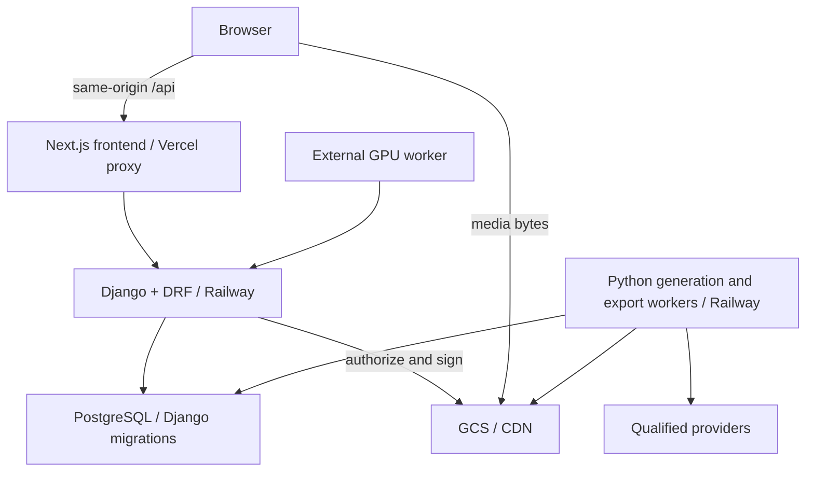

# ADR: Django is the authoritative backend destination

Date: 2026-10-07. Updated: 2026-10-15. Status: Accepted and in production. Railway Green has served
the API since the 2026-10-13 cutover (see `../operations/status.md`). The text below is the original
decision record; references to the blueprint and pending cutover describe that time.

The source-derived checkpoint and frozen fixtures define this local implementation
contract. Actual deployed identity, schema and migration history still require a
separately authorized audit. Historical Django implementations are reference
material only. The implementation blueprint governs source retirement on this
undeployed branch; the historical production ownership manifest remains unchanged.

| Responsibility | Final owner |
|---|---|
| Frontend / application shell | Next.js on Vercel |
| HTTP API, authentication, business logic | Django + DRF on Railway |
| Database models and schema evolution | Django ORM and Django migrations |
| Relational and transactional persistence | Existing PostgreSQL |
| Media/object storage | Existing GCS architecture, qualified legacy fallback |
| Background execution | Python/Django workers on Railway |
| Depth ML runtime | External/local GPU worker communicating with Django |

Django cannot be retired to resolve parity issues. New backend features belong
in Django. Transfer route methods incrementally through same-origin `/api`;
never globally switch browser API origins. A domain has one traffic owner.
The local implementation now contains only the Django backend; Node source is
retained through Git/checkpoint recovery evidence and inert golden fixtures. Live
writer retirement and rollback compatibility must be verified during the separate
cutover. Never run restored Node and Python writers concurrently.

Django is the sole managed schema authority in this local branch. Live authority
remains historical until fresh Django migrations,
complete catalog equivalence, production schema review, backup/PITR and safe
migration-history baselining pass. Do not fake migrations merely because tables
exist. After takeover Django migrations are the sole schema authority; no new
Drizzle push, ad-hoc JS schema mutations or HTTP admin migration authority.

Achieve all-business-API ownership before rewriting provider execution. Split
worker process boundaries, then qualify export and generation Python workers;
provider-by-provider shadow parity and authorized canaries precede ownership.

No frontend framework change, Cloud SQL cutover, storage redesign, or automatic
Redis/Celery/broker introduction. Preserve native MOV masters and current UI,
naming, exports, concurrency, worker fencing and shared-workspace access.

Production-impacting actions stop at the documented authorization gate. Local
safe implementation and isolated tests continue. Status and ownership manifests
must distinguish implementation/parity from deployed traffic and deletion.

