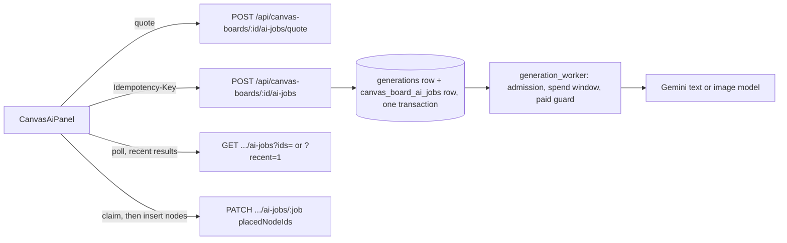

# Board "Create with AI" jobs

The board's **Create with AI** panel sits above the board toolbar (the sparkles button). An artist picks a
format, writes a prompt or picks a suggestion, chooses basic or advanced processing, sees the estimated cost, runs
it, and can keep refining the result. The result lands on the board near the viewport centre, in free space. A
refinement replaces the result it refines, in place. Both are one undo step. **Recent results** lists the user's
finished results on the board from the last 24 hours, so any of them can be placed again.
The panel and its routes need edit access to the board (`../features/board-roles.md`); a view or comment
role gets 403 and no panel.

Two formats ship today:

- **Sticky notes**: a batch of up to 24 notes from a text model, laid out on a grid. Each note has a `color` (one of
  `STICKY_COLORS` in `apps/agents/sidekick.py`: the six original names plus red, teal, black, white and grey) and a
  `fill`, a six digit hex the model sets for a colour the list has no name for. A valid hex wins over the name; an
  unknown name falls back to yellow. The frontend (`stickyFill` and `stickyInk` in `src/lib/canvas/ai-graph.js`) turns
  that into the note fill and picks light text on dark fills. Layout notes and Sidekick `add` and `update` actions
  use the same two fields.
- **Image**: an ordinary image generation, placed as an image node.

## How a job runs



- A board job is a `generations` row plus a `canvas_board_ai_jobs` row (`apps/canvas/ai_jobs.py`). The job row
  holds the board, the format, the refine parent and the nodes that hold the result.
- **Sticky notes** queue a **text job** (`kind = 'text'`, `apps/generation/services/text_submission.py`). It runs
  on the agent Gemini model (`AGENT_LLM_MODEL`) and its model name is `Gemini (<code>)`. The worker makes one
  generateContent call (`services/text_execution.py`) and stores the validated result in `generations.output`.
  Text rows are not library media: library reads and live updates leave them out, they take no library name, and
  they have no project.
- **Image** queues an ordinary image generation through `submission.submit_generation`, in the board's project. A
  refinement sends the previous image as its reference image and keeps that image's model and aspect ratio unless
  the request names others.
- Every job is created with `created_via = 'board'`.

## Processing

A request carries `processing`: `basic` (the default) or `advanced`. Both use providers and models already
configured, and both go through the same admission, spend window and paid guard.

| Format | Basic | Advanced |
| --- | --- | --- |
| Text (sticky notes) | `AGENT_LLM_MODEL` (default `gemini-flash-latest`), priced at `Board AI text` | `AGENT_LLM_MODEL_ADVANCED` (default `gemini-pro-latest`), priced at `Board AI text (advanced)` (default 1000) |
| Image | the model's default resolution | 2K where the model offers it (for a refinement, at a resolution it accepts with a reference), priced by the model's resolution pricing |

The text model is stored in the job's `submission_input`, so the worker, the payload allowlist and the paid guard
all use the model the job was quoted and priced for. The quote returns the processing, the model and the cost.

## Cost and admission

- **Pricing.** The quote and the stored `cost_cents` are estimator cents. A text job costs `Board AI text`
  (`per_million_tokens`, default 250) times the input characters / 4 plus the whole output budget, with a minimum
  of 1 cent. An image job uses the image model's normal pricing.
- **Admission.** Text jobs are admitted like Gemini images:
  - they count toward each user's `maxConcurrentJobs`
  - at most 4 run at once
  - they share the Gemini spend window (`GEMINI_SPEND_LIMIT_CENTS`) both ways.
  A held job shows the same held reason the library shows.
- **Paid guard.** The guard registers the row in the transaction that creates it.
  - In the unlimited scope, a text job is quoted to the one generateContent endpoint of its own model, and the
    single POST must be exactly the stored request (`paid_guard.text_payload_matches`).
  - The limited (priced) scope has no reviewed text quote, so it refuses board text jobs with 409
    `PREVIEW_PAID_BUDGET_HOLD`. Nothing is stored when that happens.
- **Payload allowlist.** Board prompts go through the agents payload allowlist (`apps/agents/llm.py`
  `board_payload_allowed`). The body must have exactly one format's system prompt, response schema and generation
  config. Turns must be text only (one prompt, or prompt / previous result / refinement), and the size is bounded.
  `BoardTextTransport` enforces this. Unlike the admin chat transport, it is not exempt from the paid guard.
- **No duplicate billed submission.**
  - A submission needs an `Idempotency-Key`. Its receipt, the generation row and the job row commit together, so a
    double click, a retried request or another tab with the same key returns the first job.
  - The panel reuses a key when it retries a request whose answer never arrived.
  - The worker never re-submits a text job. A billed 200 that cannot be used fails with plain copy and is not
    retried. A 429/503 fails as unbilled.
- **Gateway.** In production the submission POST is a paid initial route
  (`deploy/gateway.py` `BOARD_AI_JOBS`, 120 s wait). The gateway matches it on the decoded path in any case, as
  Django resolves it, so an uppercase board id or a percent-encoded path is the same paid route. Quotes, reads and
  placement are ordinary routes.

## Placement

The board owns its graph and autosave, so the browser places the result (`src/lib/board-ai.js`):

1. It builds the nodes (`src/lib/canvas/ai-formats.js`). A new result goes to the free slot nearest the viewport
   centre. The board area under the open panel and the asset panel counts as occupied, like existing nodes.
2. It claims the job with `PATCH placedNodeIds`. Only the first claim succeeds; a second gets 409 `ALREADY_PLACED`.
3. It inserts the nodes with `placeGeneratedNodes` as one undo step. If they are not fully visible outside those
   panels, the board pans instantly so they are. It zooms out only when the result is too large to show at the
   current zoom. The pan is not an undo step.

When a board reloads, the panel resumes the user's unfinished jobs and places finished, unplaced ones. Failed jobs
are dismissed with an empty claim. Every unfinished job is polled, and the panel follows the newest. An older job
that finishes in the background is placed but leaves the panel (its job, result, refine target and error) alone,
even after **New prompt**. **New prompt** also sends the jobs the panel follows to the background, including one
whose submission has not answered yet: their results are placed when they end, but the next prompt stays a fresh
job, not a refinement. Placements run one at a time, so results that finish together each find free space after the
previous one is on the board.

A claim is sent only while the panel still follows the job's board and that board is loaded. If the user leaves the
board while the claim is in flight, or the tab closes before autosave stores the nodes, the result is claimed but
not on the board. **Place again** recovers it:

- `GET .../ai-jobs?recent=1` lists the user's succeeded jobs on the board from the last 24 hours, placed or not.
- **Place again** inserts a fresh copy of the result in free space near the viewport centre, as one undo step. It
  never submits a job, so nothing is billed again, and it sends no claim for a result that was already placed. A
  result that was never placed is claimed first, like any first placement.

## Formats on a selection

Beyond `stickies` and `image`, the panel offers `diagram` (flowchart or mind map) and `layout` (title, frames, stickies in
frames). The selection formats `rewrite` (edit text), `recolor`, `cluster` and `summary` act on selected objects and are
reached from the panel's selection strip or the context menu's AI rows, not the format tabs. `recolor` ("Change colour"
in the strip, with a named colour or a prompt such as "make these #ff00aa") returns `{id, color, fill}` per object and
applies it with `colorPatch` (`src/lib/canvas/ai-graph.js`), the same colour rules a Sidekick `update` action uses; the
parser uses `color_fields` from `apps/agents/sidekick.py`. It reaches every selected note and shape, blank ones too, and
sets the text colour that reads on the new fill. A typed request to recolour the selection ("make these notes black",
`isRecolorRequest` in `ai-selection.js`: it must start with the request and name the selection) runs `recolor` whatever
format is picked, until the person dismisses its "Change colour" chip or picks a format. It is one undo step, and locked
objects are left alone.

- **Context.** The browser reads the selection from the board data (`src/lib/canvas/ai-selection.js`, never the
  DOM, so viewport culling does not matter) and sends `context: [{id, type, text}]`. The server bounds it
  (`context_text`: 60 items, 2000 characters each, 12000 in all; `INVALID_CONTEXT` otherwise) and appends it to the
  first user turn, so the text-only allowlist and the paid-guard body match are unchanged. The prompt limit applies
  to the user's own words only. A selection format without context is `SELECTION_REQUIRED`. A refinement sends no
  context: it reuses the first turn of the job it refines, which already holds the original selection.
- **Image references.** `referenceImages` (up to 4 URLs under `/api/media/`) on an `image` request are validated
  by the existing enqueue path. Selected board images become references of a new image, so the original stays.
- **Placement kinds** in `AI_FORMATS`: `nodes` (new objects), `graph` (new objects and connectors, placed with
  `placeGeneratedNodes`; a refined result replaces the result it refines) and `edit` (rewrites
  selected objects in place with `applyBoardAiEdit`, one undo step; locked objects are skipped). An `edit` format
  claims the ids it changed, never becomes the refine target and never deletes anything.
- **Entry points** follow a per-browser preference (`veevee.board.aiInputs`, `src/lib/board-ai-panel.js`; the app has
  no per-user preference store). Turning AI off hides the toolbar sparkle, the panel and the menu rows. Every action
  still needs the person to press Generate, so nothing paid starts on its own.
- **Not built**: Doc, table, Kanban, timeline, slides and prototype outputs (the board has no such objects from this
  slice), vision inputs (sticky capture, digitize, alt-text, screenshot to prototype: the paid guard pins the exact
  text-only body), remove background (no provider is configured), and comment-thread summaries (comments are not part
  of the board JSON).

## Adding a format

- **A text format** adds:
  - an entry to `TEXT_FORMATS` in `apps/agents/board.py`: prompt, schema, output budget and parser
  - its name in `ENGINES` in `apps/canvas/ai_jobs.py` (and `SELECTION_FORMATS` if it needs a selection)
  - an entry in `AI_FORMATS` (`src/lib/canvas/ai-formats.js`): label, suggestions and a `nodes`, `graph` or `edit` builder.
- **A format that needs new node types** waits for those node types on the board.

## Tests

- `backend/apps/canvas/test_ai_jobs.py` covers:
  - the allowlist, the paid-guard quote and payload
  - idempotent submission, admission, the spend window and the paid hold
  - worker execution against the fake provider
  - refinement, placement, and the migration.
- `src/lib/board-ai.test.js`, `src/lib/canvas/ai-formats.test.js`, `ai-graph.test.js`, `ai-selection.test.js` and `src/components/canvas/CanvasAiPanel.test.js`
  cover the browser side.
- `tests/browser/board-ai.spec.mjs` and `board-ai-selection.spec.mjs` are the end-to-end flows. Run it against the fake provider server with:

  ```
  scripts/dev/test-db.sh PYTHON scripts/dev/browser-harness.py --fake-providers --grep "Create with AI"
  ```
