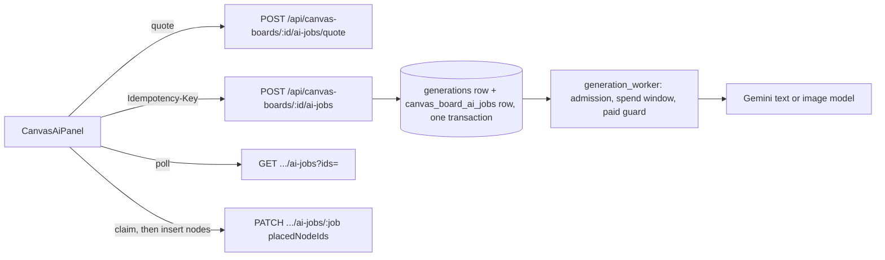

# Board "Create with AI" jobs

The board's **Create with AI** panel sits above the board toolbar (the sparkles button). An artist picks a
format, writes a prompt or picks a suggestion, sees the estimated cost, runs it, and can keep refining the
result. The result lands on the board near the viewport centre, in free space. A refinement replaces the result
it refines, in place. Both are one undo step.

Two formats ship today:

- **Sticky notes**: a batch of up to 24 notes from a text model, laid out on a grid.
- **Image**: an ordinary image generation, placed as an image node.

## How a job runs



- A board job is a `generations` row plus a `canvas_board_ai_jobs` row (`apps/canvas/ai_jobs.py`). The job row
  holds the board, the format, the refine parent and the nodes that hold the result.
- **Sticky notes** queue a **text job** (`kind = 'text'`, `apps/generation/services/text_submission.py`). It runs
  on the agent Gemini model (`AGENT_LLM_MODEL`) and its model name is `Gemini (<code>)`. The worker makes one
  generateContent call (`services/text_execution.py`) and stores the validated result in `generations.output`.
  Text rows are not library media: library reads and live updates leave them out, they take no library name, and
  they have no project.
- **Image** queues an ordinary image generation through `submission.submit_generation`, in the board's project. A
  refinement sends the previous image as its reference image.
- Every job is created with `created_via = 'board'`.

## Cost and admission

- **Pricing.** The quote and the stored `cost_cents` are estimator cents. A text job costs `Board AI text`
  (`per_million_tokens`, default 250) times the input characters / 4 plus the whole output budget, with a minimum
  of 1 cent. An image job uses the image model's normal pricing.
- **Admission.** Text jobs are admitted like Gemini images:
  - they count toward each user's `maxConcurrentJobs`
  - at most 4 run at once
  - they share the Gemini spend window (`GEMINI_SPEND_LIMIT_CENTS`) both ways.
  A held job shows the same held reason the library shows.
- **Paid guard.** The guard registers the row in the transaction that creates it.
  - In the unlimited scope, a text job is quoted to the one generateContent endpoint of its own model, and the
    single POST must be exactly the stored request (`paid_guard.text_payload_matches`).
  - The limited (priced) scope has no reviewed text quote, so it refuses board text jobs with 409
    `PREVIEW_PAID_BUDGET_HOLD`. Nothing is stored when that happens.
- **Payload allowlist.** Board prompts go through the agents payload allowlist (`apps/agents/llm.py`
  `board_payload_allowed`). The body must have exactly one format's system prompt, response schema and generation
  config. Turns must be text only (one prompt, or prompt / previous result / refinement), and the size is bounded.
  `BoardTextTransport` enforces this. Unlike the admin chat transport, it is not exempt from the paid guard.
- **No duplicate billed submission.**
  - A submission needs an `Idempotency-Key`. Its receipt, the generation row and the job row commit together, so a
    double click, a retried request or another tab with the same key returns the first job.
  - The panel reuses a key when it retries a request whose answer never arrived.
  - The worker never re-submits a text job. A billed 200 that cannot be used fails with plain copy and is not
    retried. A 429/503 fails as unbilled.
- **Gateway.** In production the submission POST is a paid initial route
  (`deploy/gateway.py` `BOARD_AI_JOBS`, 120 s wait). Quotes, reads and placement are ordinary routes.

## Placement

The board owns its graph and autosave, so the browser places the result (`src/lib/board-ai.js`):

1. It builds the nodes (`src/lib/canvas/ai-formats.js`).
2. It claims the job with `PATCH placedNodeIds`. Only the first claim succeeds; a second gets 409 `ALREADY_PLACED`.
3. It inserts the nodes with `placeGeneratedNodes` as one undo step.

When a board reloads, the panel resumes the user's unfinished jobs and places finished, unplaced ones. Failed jobs
are dismissed with an empty claim.

## Adding a format

Doc, diagram, mind map, table, Kanban, timeline and slides plug in without rework:

- **A text format** adds:
  - an entry to `TEXT_FORMATS` in `apps/agents/board.py`: prompt, schema, output budget and parser
  - its name in `ENGINES` in `apps/canvas/ai_jobs.py`
  - an entry in `AI_FORMATS` (`src/lib/canvas/ai-formats.js`): label, suggestions and a node builder.
- **A format that needs new node types** waits for those node types on the board (checklist area B).

## Tests

- `backend/apps/canvas/test_ai_jobs.py` covers:
  - the allowlist, the paid-guard quote and payload
  - idempotent submission, admission, the spend window and the paid hold
  - worker execution against the fake provider
  - refinement, placement, and the migration.
- `src/lib/board-ai.test.js`, `src/lib/canvas/ai-formats.test.js` and `src/components/canvas/CanvasAiPanel.test.js`
  cover the browser side.
- `tests/browser/board-ai.spec.mjs` is the end-to-end flow. Run it against the fake provider server with:

  ```
  scripts/dev/test-db.sh PYTHON scripts/dev/browser-harness.py --fake-providers --grep "Create with AI"
  ```
