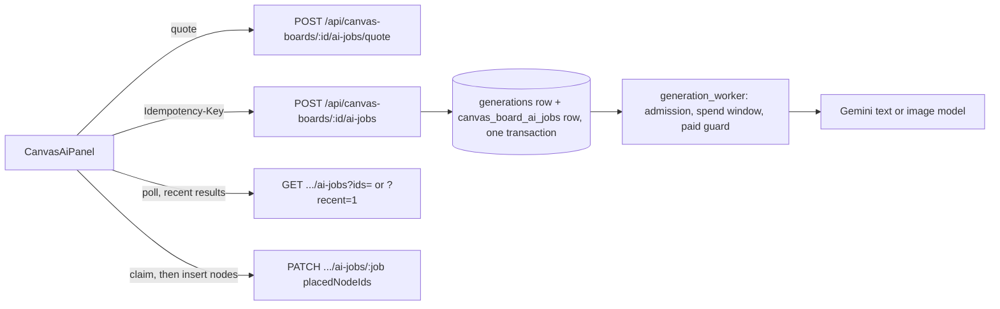

# Board "Create with AI" jobs

The board's **Create with AI** panel sits above the board toolbar (the sparkles button). An artist picks a
format, writes a prompt or picks a suggestion, chooses basic or advanced processing, sees the estimated cost, runs
it, and can keep refining the result. The result lands on the board near the viewport centre, in free space. A
refinement replaces the result it refines, in place. Both are one undo step. **Recent results** lists the user's
finished results on the board from the last 24 hours, so any of them can be placed again.
The panel and its routes need edit access to the board (`../features/board-roles.md`); a view or comment
role gets 403 and no panel.

Two formats ship today:

- **Sticky notes**: a batch of up to 24 notes from a text model, laid out on a grid.
- **Image**: an ordinary image generation, placed as an image node.

## How a job runs



- A board job is a `generations` row plus a `canvas_board_ai_jobs` row (`apps/canvas/ai_jobs.py`). The job row
  holds the board, the format, the refine parent and the nodes that hold the result.
- **Sticky notes** queue a **text job** (`kind = 'text'`, `apps/generation/services/text_submission.py`). It runs
  on the agent Gemini model (`AGENT_LLM_MODEL`) and its model name is `Gemini (<code>)`. The worker makes one
  generateContent call (`services/text_execution.py`) and stores the validated result in `generations.output`.
  Text rows are not library media: library reads and live updates leave them out, they take no library name, and
  they have no project.
- **Image** queues an ordinary image generation through `submission.submit_generation`, in the board's project. A
  refinement sends the previous image as its reference image and keeps that image's model and aspect ratio unless
  the request names others.
- Every job is created with `created_via = 'board'`.

## Processing

A request carries `processing`: `basic` (the default) or `advanced`. Both use providers and models already
configured, and both go through the same admission, spend window and paid guard.

| Format | Basic | Advanced |
| --- | --- | --- |
| Text (sticky notes) | `AGENT_LLM_MODEL` (default `gemini-flash-latest`), priced at `Board AI text` | `AGENT_LLM_MODEL_ADVANCED` (default `gemini-pro-latest`), priced at `Board AI text (advanced)` (default 1000) |
| Image | the model's default resolution | 2K where the model offers it (for a refinement, at a resolution it accepts with a reference), priced by the model's resolution pricing |

The text model is stored in the job's `submission_input`, so the worker, the payload allowlist and the paid guard
all use the model the job was quoted and priced for. The quote returns the processing, the model and the cost.

## Cost and admission

- **Pricing.** The quote and the stored `cost_cents` are estimator cents. A text job costs `Board AI text`
  (`per_million_tokens`, default 250) times the input characters / 4 plus the whole output budget, with a minimum
  of 1 cent. An image job uses the image model's normal pricing.
- **Admission.** Text jobs are admitted like Gemini images:
  - they count toward each user's `maxConcurrentJobs`
  - at most 4 run at once
  - they share the Gemini spend window (`GEMINI_SPEND_LIMIT_CENTS`) both ways.
  A held job shows the same held reason the library shows.
- **Paid guard.** The guard registers the row in the transaction that creates it.
  - In the unlimited scope, a text job is quoted to the one generateContent endpoint of its own model, and the
    single POST must be exactly the stored request (`paid_guard.text_payload_matches`).
  - The limited (priced) scope has no reviewed text quote, so it refuses board text jobs with 409
    `PREVIEW_PAID_BUDGET_HOLD`. Nothing is stored when that happens.
- **Payload allowlist.** Board prompts go through the agents payload allowlist (`apps/agents/llm.py`
  `board_payload_allowed`). The body must have exactly one format's system prompt, response schema and generation
  config. Turns must be text only (one prompt, or prompt / previous result / refinement), and the size is bounded.
  `BoardTextTransport` enforces this. Unlike the admin chat transport, it is not exempt from the paid guard.
- **No duplicate billed submission.**
  - A submission needs an `Idempotency-Key`. Its receipt, the generation row and the job row commit together, so a
    double click, a retried request or another tab with the same key returns the first job.
  - The panel reuses a key when it retries a request whose answer never arrived.
  - The worker never re-submits a text job. A billed 200 that cannot be used fails with plain copy and is not
    retried. A 429/503 fails as unbilled.
- **Gateway.** In production the submission POST is a paid initial route
  (`deploy/gateway.py` `BOARD_AI_JOBS`, 120 s wait). The gateway matches it on the decoded path in any case, as
  Django resolves it, so an uppercase board id or a percent-encoded path is the same paid route. Quotes, reads and
  placement are ordinary routes.

## Placement

The board owns its graph and autosave, so the browser places the result (`src/lib/board-ai.js`):

1. It builds the nodes (`src/lib/canvas/ai-formats.js`). A new result goes to the free slot nearest the viewport
   centre. The board area under the open panel and the asset panel counts as occupied, like existing nodes.
2. It claims the job with `PATCH placedNodeIds`. Only the first claim succeeds; a second gets 409 `ALREADY_PLACED`.
3. It inserts the nodes with `placeGeneratedNodes` as one undo step. If they are not fully visible outside those
   panels, the board pans instantly so they are. It zooms out only when the result is too large to show at the
   current zoom. The pan is not an undo step.

When a board reloads, the panel resumes the user's unfinished jobs and places finished, unplaced ones. Failed jobs
are dismissed with an empty claim.

A claim is sent only while the panel still follows the job's board and that board is loaded. If the user leaves the
board while the claim is in flight, or the tab closes before autosave stores the nodes, the result is claimed but
not on the board. **Place again** recovers it:

- `GET .../ai-jobs?recent=1` lists the user's succeeded jobs on the board from the last 24 hours, placed or not.
- **Place again** inserts a fresh copy of the result in free space near the viewport centre, as one undo step. It
  never submits a job, so nothing is billed again, and it sends no claim for a result that was already placed. A
  result that was never placed is claimed first, like any first placement.

## Adding a format

Doc, diagram, mind map, table, Kanban, timeline and slides plug in without rework:

- **A text format** adds:
  - an entry to `TEXT_FORMATS` in `apps/agents/board.py`: prompt, schema, output budget and parser
  - its name in `ENGINES` in `apps/canvas/ai_jobs.py`
  - an entry in `AI_FORMATS` (`src/lib/canvas/ai-formats.js`): label, suggestions and a node builder.
- **A format that needs new node types** waits for those node types on the board (checklist area B).

## Tests

- `backend/apps/canvas/test_ai_jobs.py` covers:
  - the allowlist, the paid-guard quote and payload
  - idempotent submission, admission, the spend window and the paid hold
  - worker execution against the fake provider
  - refinement, placement, and the migration.
- `src/lib/board-ai.test.js`, `src/lib/canvas/ai-formats.test.js` and `src/components/canvas/CanvasAiPanel.test.js`
  cover the browser side.
- `tests/browser/board-ai.spec.mjs` is the end-to-end flow. Run it against the fake provider server with:

  ```
  scripts/dev/test-db.sh PYTHON scripts/dev/browser-harness.py --fake-providers --grep "Create with AI"
  ```
