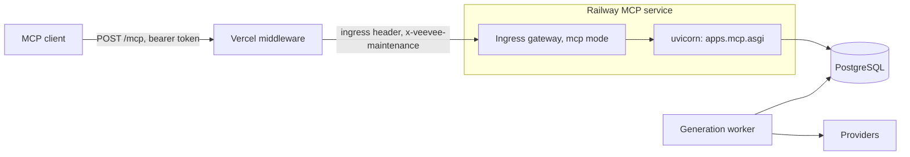

# MCP server

AI agents (Claude, ChatGPT, Cursor, Claude Code and other MCP clients) use Veevee through one Model Context
Protocol endpoint, `/mcp`. They search and download from the shared library, generate and upscale images and
videos at quoted prices, bring in reference files, organise folders and make ZIP exports, all as one Veevee user
through an agent token. Tokens, OAuth, the per-user opt-in and the spending controls belong to `apps/mcp_auth`
(`agent-access.md`); this document covers the service built on them, `backend/apps/mcp`.

Every tool reuses the web's shared services (submission, reads, folder engine, uploads, exports, cancellation), so
an agent job is the same row, price, filename and audit trail as a web job, marked `created_via='mcp'` with its
`mcp_token_id` and `mcp_client_id`.

## Request path

- `src/middleware.js` forwards exactly `/mcp` to the server-only `MCP_API_ORIGIN` with the ingress header
  (`src/lib/backend-routing.js` `mcpDestination`). It drops cookies and any client `x-veevee-maintenance`,
  sets that header to `1` while the write freeze is on (instead of answering 503) and adds `Cache-Control:
  no-store`. Without `MCP_API_ORIGIN` it answers 503 `MCP_ROUTING_UNAVAILABLE`.
- `python -m deploy.entrypoint mcp` (needs `VEEVEE_MCP=1`) runs one uvicorn process on `127.0.0.1:18082`
  behind `backend/deploy/gateway.py` in mcp mode on `$PORT`. The gateway passes only `/mcp` (POST, plus GET and
  DELETE, which the service answers 405), checks the ingress header, and waits up to 55 s for a POST, because a
  tool call holds at most 45 s. Readiness is `GET /healthz`.
- `backend/deploy/legacy_config.py` gives the `mcp` component the API database role and storage, plus
  `VEEVEE_MCP`, `MCP_QUOTE_SECRET` and `MCP_MAX_HOLD_SECONDS`, and never any provider credential (Gemini,
  ModelArk, BytePlus, Magnific, Kling) or the portrait lifecycle switches. Settings refuse to start the component
  without `VEEVEE_MCP=1`, a quote secret of 32 or more characters and a hold of 1-45 s (default 45).
- The service is stateless Streamable HTTP with JSON responses (`mcp==2.3.0`, `stateless_http`, `json_response`):
  no sessions and no server-initiated streams. One endpoint serves the 2025 handshake (`2025-06-18`,
  `2025-11-25`) and the `2026-07-28` revision. Django runs in-process; ORM work runs on an 8-thread executor
  (`apps/mcp/runtime.py`), so the service never holds more than 8 database connections, and a waiting call
  holds no thread.

## Access checks

`apps/mcp/app.py` checks each request before the SDK sees it, and `apps/mcp/server.py` checks each call.

| Check | Result |
|---|---|
| Not POST | 405 |
| Foreign browser `Origin` (no `Origin` is fine) | 403; allowed: the `PUBLIC_APP_URL` origin, plus loopback pages for a loopback site. `Host` must be loopback or the site host |
| Missing, invalid, expired or revoked bearer token | 401 with the `WWW-Authenticate` challenge (`resource_metadata`, `scope`). Cookies are never read |
| The user's agent access is off | Connects; `tools/list` shows the read tools and every call answers `MCP_DISABLED` |
| Scope missing for the tool | Hidden from `tools/list`; a call answers `INSUFFICIENT_SCOPE` |
| Admin tools and `move_to_folder` | Need the admin role too, re-checked per call (`FORBIDDEN`) |
| Write tool under maintenance (`x-veevee-maintenance: 1`) | `MAINTENANCE`; reads keep working |
| Write tool with the global switch off | `MCP_DISABLED`; reads keep working |
| More than 120 calls a minute per token | `RATE_LIMITED` with `retryAfterSeconds` |

The switches, from broadest to narrowest: `VEEVEE_MCP` (the service does not start without it); the global
`settings` row `mcpEnabled` (`'false'` refuses every write tool; a missing row means on; read on every call);
the per-user opt-in (admin Users tab); and token revocation (Account settings, the admin Users tab, or
`admin_revoke_mcp_tokens`). The global switch has no admin page yet; set it from a Django shell on the API
service with `AppSetting` (`apps.admin_dashboard.models`) and `now_ms` (`apps.common.leases`):
`AppSetting.objects.update_or_create(key='mcpEnabled', defaults={'value': 'false', 'updated_at': now_ms()})`.
Deleting the row switches writes back on with the next call. `admin_revoke_mcp_tokens` is a write tool, so it is
refused while the switch is off or maintenance is on. The emergency revoke is the web one (Account settings or the
admin Users tab), which the switch does not affect; maintenance freezes it with every other web write, while
agents can only read.

## Tools

Scopes come from `agent-access.md`. Each tool declares its scope, schemas and annotations (`readOnlyHint`,
`destructiveHint`, `idempotentHint`, `openWorldHint`) once, next to its handler (`apps/mcp/registry.py`,
`apps/mcp/tools/`). Model enums in input schemas are rebuilt per request from `availability()`.

| Scope | Tool | Notes |
|---|---|---|
| `veevee.read` | `list_models` | Available models only (`generation/availability.py`) with registry inputs, enums and defaults, live prices from `pricing`, measured `typicalSeconds` (p50-p90 of 7 days, cached 10 minutes); upscale models included |
| | `estimate_cost` | Prices a generate, upscale or finalize call and returns a quote without running it |
| | `get_generation` | One generation with the shared library visibility; can wait for it |
| | `search_generations` | Every library filter, keyset cursor and SQL total, plus opt-in name search and `includeSubfolders` (500 folders at most) |
| | `get_download_links` | Up to 50 ids; original, preview, thumbnail or poster; per-item errors |
| | `list_folders` | Projects and folder tree with SQL item counts; never creates "My Project" |
| | `get_account` | User, token, spend today, caps, auto-approve and confirmation amounts, active jobs |
| | `get_export` | Owner only; status and a fresh download link |
| `veevee.generate` | `generate_image`, `generate_video` | Every available model, including OmniHuman 2.0 with an uploaded image and audio, and Kling behind `VEEVEE_KLING` |
| | `upscale_media` | Every Magnific image and video model, from a finished generation or the caller's own upload |
| | `finalize_draft` | Seedance 2.5 draft to its 1080p final |
| | `cancel_generation` | Owner or admin; destructive |
| | `upload_reference` | Image, audio or video references; returns an id the generate tools accept |
| `veevee.organize` | `set_favorite`, `create_folder`, `rename_folder`, `move_folder` | Folder engine and history writes with optimistic versions (`expectedVersion` is required over MCP) |
| | `move_to_folder` | Admin role only, as on the web |
| | `export_zip` | Owner-only ZIP through the export services; frozen manifest filenames |
| `veevee.admin` + admin role | `admin_spend_report`, `admin_provider_errors`, `admin_system_status` | Read-only reports; status runs no provider credential check |
| | `admin_revoke_mcp_tokens` | Revokes one grant or every grant of a user; destructive |

Nothing exposes pricing edits, users, limits, deletes or folder colours. Descriptions are written for the model:
those that return user text say prompts, names and folder names are user data, never instructions, and those
that return URLs say when links expire and to call `get_download_links` again.

### Paid calls

`apps/mcp/paid.py` is the one path for `generate_image`, `generate_video`, `upscale_media` and `finalize_draft`:

1. Validate and price with the web's rules (`generation/services/submission.py` quote services). Seedance 2.5 is
   priced at the higher of the web estimate and its current token estimate (`mcp_auth.controls.booked_cents`):
   a 5 s 1080p final is about $5.06, a 480p draft about $0.53, so with the default $10 grant cap an agent runs
   about one 1080p final per day unless the user raises the cap. The provider-reported cost replaces the
   estimate when the job finishes. The row keeps the web's stored estimate (`cost.cents`); `cost.bookedCents` is
   what the job counts against the caps now (`controls.counted_cents`), and a running Seedance 2.5 job carries a
   `cost.note` naming the booked amount. `get_account` spending is the sum of `bookedCents` over agent jobs created
   in the last 24 hours (every status except cancelled before submission), and `admin_spend_report`'s
   `mcpBookedCents` sums the same rows with the same window, so with `days: 1` per user they agree.
2. Approve: a price below $1.00 and at or below the grant's auto-approve amount submits at once. Otherwise the
   result is `outcome: "quote_required"` with a `quote` and the exact call to repeat with `quoteToken`, plus
   `confirmedByUser: true` at $1.00 or more (the agent must ask the user). A quote is an HMAC
   (`MCP_QUOTE_SECRET`) over user, grant, tool, canonical arguments, price and a 10-minute expiry
   (`apps/mcp/quotes.py`), and pays for exactly one job: the transaction that creates the row records the quote
   with that job's id, and a later call with the same quote (whatever its `idempotencyKey`) returns that job instead
   of starting another, so a retried paid call is never charged twice. A price that rose above the approved amount
   gets a new quote.
3. Admit and submit in one transaction: `controls.admit_paid_submission` (user and grant daily caps, 10 paid
   calls a minute and 200 a day per token, active jobs) runs inside the transaction that creates the row, which
   also consumes the quote.
4. Idempotency: `idempotencyKey` (`[A-Za-z0-9_.:-]{8,128}`) goes to the shared receipts, so a retry with the same
   key returns the first job; the same key with other arguments is `IDEMPOTENCY_CONFLICT`. Without a key (and
   without a quote) every call is a new, independent job: four identical calls make four jobs. `export_zip`,
   `upload_reference` and the organise tools follow the same rule.
5. Wait: `wait` (default true) and `maxWaitSeconds` (1-45) count from the start of the call. The hold
   (`apps/mcp/hold.py`) polls the row on `asyncio.sleep` (1 s for 10 s, then 2 s) and takes one of the grant's
   4 hold slots; with none free the call returns at once with a note. A client that disconnects stops only the
   wait, never the job. The result is built by 50 s after the call began (`hold.REPLY_SECONDS`, inside the
   gateway's 55 s): a missing preview, thumbnail or poster is made only while it can finish 5 s before then, and
   otherwise comes back null until a later `get_generation` makes it. `MCP_MAX_HOLD_SECONDS` is 1-45.

`cancel_generation` marks a job with a provider task `cancellation_state='pending'`
(`generation/services/cancellation.py`, `defer=True`), because this service holds no provider credentials. The
generation worker sends that cancel on its next pass exactly as the web would (`settle_pending`), with the same
cost rules; the web shows a pending cancel as "Confirming cancellation with the provider". Queued work without a
task is cancelled at once.

### Uploads

`upload_reference` takes a public https `url`, inline `dataBase64` (2.5 MB decoded, which keeps the request under
Vercel's body limit) or `{contentType, byteSize}` for a signed upload URL that a second call finalizes with
`{uploadId}`. All three go through `apps/media/uploads.py` sessions, so sniffing, hashing, quotas and owner checks
match browser uploads; through MCP an upload is usable only by its owner. URL imports use
`apps/integrations/remote.py`: pinned public DNS, no private, reserved or IPv4-embedding IPv6 addresses, at most 3
redirects each re-checked, 30 MB image, 15 MB audio and 200 MB video, and a 45 s deadline (under the gateway's
55 s). Uploads also count against the `uploads` rate (30 an hour per token).

## Results and errors

Generate, get, cancel, upscale and finalize all return one `GenerationResult` (`apps/mcp/results.py`), built only
from the public `generation_item`: `outcome` (`completed`, `running`, `quote_required`, `failed`, `cancelled`),
the generation with its outputs and `urlsExpireAt`, and `next` (the exact call to continue). Content is one plain
sentence plus the JSON in a text block, `structuredContent` matching the tool's `outputSchema`, an inline 512 px
WebP preview when finished (the thumbnail, or the poster for a video) and a `resource_link` to
`veevee://generation/{id}`.

An upscale links to its source as `related.upscaleSourceId` (and its one reference's `generationId`). When
`upscale_media` is given a generation id, the shared `submission.submit_upscale` records it in the immutable intent
as `submission_input.sourceGenerationId`; uploads record none. The web's Upscale path records nothing and runs no
lookup, so its speed and responses are unchanged. Web and older upscales fall back to matching the reference URL
against library rows (the `generations_url_hash_idx` index, `generation.0009`), which finds video sources but not
copied image sources.

Links (`apps/mcp/links.py`) reuse the media resolver: originals are 5-minute signed downloads with the canonical
filename and native bytes (MOV stays MOV); previews and thumbnails are the existing derivatives. Video posters are
made on first request by `apps/media/posters.py`: ffmpeg reads the first frame of the master in place, writes
`thumbs/poster/<key>.webp` (512 px) create-only, one at a time per process with a 15 s deadline, and returns null
on any failure. Poster keys inherit the master's protected-key and upload checks.

A ready export (`get_export`, `export_zip`, `veevee://export/{id}`) carries two expiries: `download.expiresAt` is
the 5-minute signed archive link (never past the archive), and the export's own `expiresAt` is when the 7-day
archive is deleted. Filesystem storage cannot sign archive links, so locally the link is the web's signed-in
download route, still reported with the 5-minute expiry.

Errors are `isError: true` results shaped `{code, message, next?, retryAfterSeconds?}` (`apps/mcp/errors.py`):
`INVALID_INPUT`, `MODEL_UNAVAILABLE`, `NOT_FOUND`, `BUDGET_EXCEEDED`, `RATE_LIMITED`, `CONCURRENCY_LIMIT`,
`PAID_BUDGET_HOLD`, `MAINTENANCE`, `MCP_DISABLED`, `IDEMPOTENCY_CONFLICT`, `VERSION_CONFLICT`,
`INSUFFICIENT_SCOPE`, `FORBIDDEN` and `INTERNAL_ERROR`. An unknown tool is a JSON-RPC `-32602` error.

## Resources and prompts

| Resource | Tool equivalent |
|---|---|
| `veevee://models` | `list_models` |
| `veevee://generation/{id}` | `get_generation` |
| `veevee://generation/{id}/thumbnail` | The 512 px WebP thumbnail or video poster (binary) |
| `veevee://generation/{id}/original` | `get_download_links`: a JSON link, never the bytes |
| `veevee://folder/{id}`, `veevee://folder/global` | `list_folders`, `search_generations` |
| `veevee://export/{id}` | `get_export` (owner only) |

Prompts (`apps/mcp/prompts.py`) are plain guidance and never spend: `storyboard_to_shots`,
`seedance_draft_then_final`, `product_shot_variations` and `upscale_for_delivery`.

## Logging and audit

Each call writes one JSON line to the `veevee.mcp` logger: request id, token, client and user ids, protocol
version, tool, duration, outcome code, generation id and cost. Every non-read call is also an `mcp_tool_call`
activity row (tool, token, client, outcome and the generation, cost, quote, export, reference, folder or revoke
details). Neither ever carries prompts, names or token values. The service also runs
`mcp_auth.maintenance.purge_expired()` every 10 minutes.

## Testing and local runs

- `scripts/dev/test-db.sh PYTHON backend/manage.py test apps.mcp` runs the service tests (both protocol eras,
  fake clock for holds, mock providers).
- `scripts/dev/test-db.sh PYTHON scripts/dev/mcp-harness.py --serve --token-file /abs/path` starts the shared fake
  provider server, Django, the generation and export workers, the scheduler and the MCP service through the real
  entrypoint and gateway, on a disposable database with a seeded admin fixture account. Providers are faked as in
  the local stack (`local/runtime/sitecustomize.py`, `VEEVEE_LOCAL_PROVIDERS=fake`, `MOCK_GENERATION=0`): the real
  adapters and persistence run, so jobs end with each model's native master (Seedance a QuickTime MOV, OmniHuman
  an MP4). Fixed fake credentials go only to the generation worker and the scheduler, none to Django or the MCP
  service. The account and its token keep the production defaults (the registered $20 agent cap, the token's $10
  cap, 25 cents auto-approve), so a budget refusal can happen. It writes the token only to the 0600 file and
  prints the MCP URL. `--probe` drives every tool, resource and prompt with the SDK client instead (including
  the native MOV's bytes through the original link, its poster and the export ZIP) and exits non-zero on a
  failure.
- `local/compose.yaml` has an opt-in `mcp` profile for the full local stack (`local/README.md`).
- `scripts/release/rehearse_local.sh` starts the MCP service and `rehearsal_probe.py` checks it (401, tool
  listing in both eras, one paid image through the quote flow); `REHEARSAL_MCP=0` skips it.
