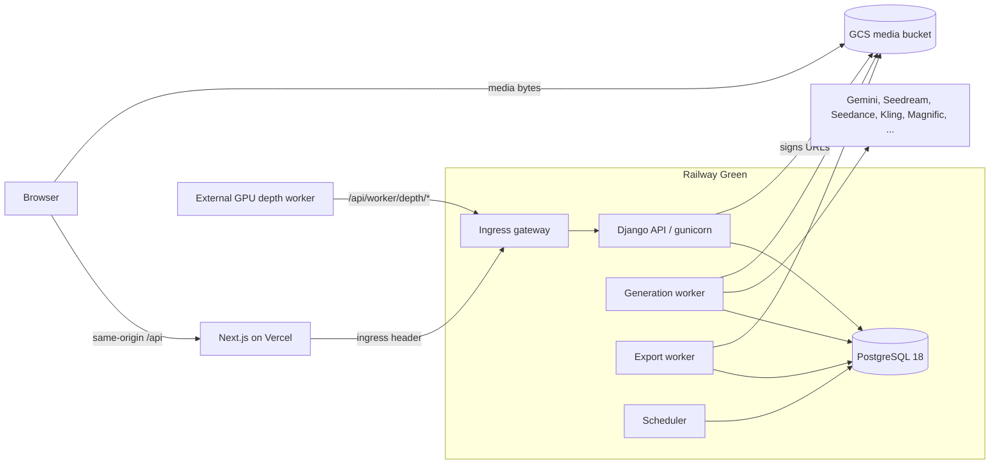

# Architecture overview

Veevee is an internal image and video production application. Artists compose prompts with
references, generate images and videos through hosted providers, organise results in a
project/folder library, and export native masters.

## Runtime pieces

| Piece | Code | Notes |
|---|---|---|
| Frontend | `src/` | Next.js App Router, React, Zustand. `src/middleware.js` forwards every `/api/*` request to Django with the server-only ingress header. No route handlers and no backend credentials live here. |
| Ingress gateway | `backend/deploy/gateway.py` | Runs in front of gunicorn in the API service. Refuses requests without the ingress header and blocks non-allowlisted routes (see F-07 in `operations/status.md`). |
| API | `backend/config`, `backend/apps/*` | Django + DRF. Started by `python -m deploy.entrypoint api`. |
| Generation worker | `apps/generation` (`generation_worker`) | Admission, provider submission, task receipts, polling and terminal state. |
| Export worker | `apps/exports` (`media_export_worker`) | Builds private ZIP archives from frozen manifests. |
| Scheduler | `apps/workers` (`run_scheduler`) | Depth/video reconciliation, export and login-attempt cleanup, portrait janitor. |
| Depth worker | `depth-worker/` | Runs on a GPU machine and talks to the fenced depth HTTP protocol. |
| Database | `backend/apps/*/migrations` | One Django migration graph; production tables, roles and row-level security are described in `operations/status.md`. |

Which commit each Railway service runs, and its rollback target, is
recorded in `operations/status.md`. Releases follow `operations/release-runbook.md`.

## Backend apps (`backend/apps`)

| App | Responsibility |
|---|---|
| `authentication` | Sessions, passwords, login throttling, profile |
| `projects` | Projects and briefs |
| `library` | Folder tree, naming counters, filenames, idempotency receipts |
| `assets` | Material catalog, legacy and managed BytePlus portraits, face detection |
| `canvas` | Canvas boards |
| `agents` | Gemini tool-loop chat |
| `generation` | Enqueue, history and live updates, providers, prompting, worker execution |
| `exports` | ZIP manifests and the export worker |
| `workers` | Depth protocol, depth enqueue, cron routes, scheduler |
| `media` | Storage, uploads, signed grants, remote fetch, downloads, audio transcription |
| `admin_dashboard` | Admin views, pricing, settings, limits, status checks |
| `common` | Middleware, leases, responses, health, activity log |
| `production_runtime` | Green production policies: paid guard, export admission, namespaces, portrait lifecycle |

`backend/testsupport` holds fake providers and the frozen historical Node outputs used as test
oracles. `backend/deploy` holds the entrypoint, the gateway and the legacy configuration reader.

## Repository layout

| Path | Contents |
|---|---|
| `backend/` | Django project, Dockerfile for every Railway service |
| `src/` | Next.js frontend |
| `tests/browser/` | Playwright specs run through Django by `scripts/dev/browser-harness.py` |
| `local/` | Full local stack (Docker Compose, fake providers, restored Green copy) |
| `scripts/release/` | Release gate, local rehearsal, Railway staging |
| `scripts/dev/` | Disposable test database runner and the browser harness |
| `depth-worker/` | GPU depth worker |
| `infra/gcp/` | Media bucket CORS and lifecycle configuration |
| `docs/` | This documentation |
