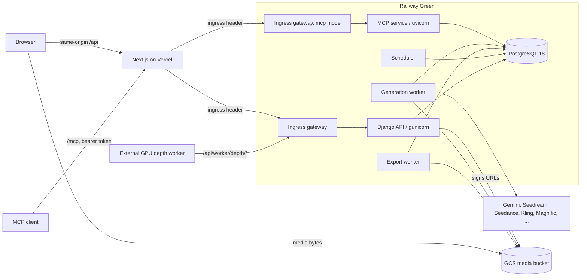

# Architecture overview

Veevee is an internal image and video production application. Artists compose prompts with
references, generate images and videos through hosted providers, organise results in a
project/folder library, and export native masters.

## Runtime pieces

| Piece | Code | Notes |
|---|---|---|
| Frontend | `src/` | Next.js App Router, React, Zustand. `src/middleware.js` forwards `/api/*` requests to Django with the server-only ingress header, after enforcing the maintenance write freeze and answering `GET /api/maintenance` itself (see `operations/release-runbook.md`). It forwards `/mcp` to the MCP service (`MCP_API_ORIGIN`) with the maintenance state in a header. No route handlers and no backend credentials live here. |
| Ingress gateway | `backend/deploy/gateway.py` | Runs in front of gunicorn in the API service. Refuses requests without the ingress header and blocks non-allowlisted routes (see F-07 in `operations/status.md`). |
| API | `backend/config`, `backend/apps/*` | Django + DRF. Started by `python -m deploy.entrypoint api`. |
| MCP service | `apps/mcp` | The agent endpoint `/mcp`: one uvicorn process with Django in-process, behind the gateway in mcp mode, started by `python -m deploy.entrypoint mcp`. API database role, no provider credentials (`mcp-server.md`). |
| Generation worker | `apps/generation` (`generation_worker`) | Admission, provider submission, task receipts, polling and terminal state. |
| Export worker | `apps/exports` (`media_export_worker`) | Builds private ZIP archives from frozen manifests. |
| Scheduler | `apps/workers` (`run_scheduler`) | Depth/video reconciliation, export and login-attempt cleanup, portrait janitor. |
| Depth worker | `depth-worker/` | Runs on a GPU machine and talks to the fenced depth HTTP protocol. |
| Database | `backend/apps/*/migrations` | One Django migration graph; production tables, roles and row-level security are described in `operations/status.md`. |

Which commit each Railway service runs, and its rollback target, is
recorded in `operations/status.md`. Releases follow `operations/release-runbook.md`.

## Backend apps (`backend/apps`)

| App | Responsibility |
|---|---|
| `authentication` | Sessions, passwords, login throttling, profile |
| `projects` | Projects and briefs |
| `library` | Folder tree, naming counters, filenames, idempotency receipts |
| `assets` | Material catalog, legacy and managed BytePlus portraits, face detection |
| `canvas` | Canvas boards |
| `agents` | Gemini tool-loop chat |
| `generation` | Enqueue, history and live updates, providers, prompting, worker execution |
| `exports` | ZIP manifests and the export worker |
| `workers` | Depth protocol, depth enqueue, cron routes, scheduler |
| `media` | Storage, uploads, signed grants, downloads, audio transcription |
| `admin_dashboard` | Admin views, pricing, settings, limits, status checks, provider error log (`/api/admin/errors`) |
| `mcp_auth` | Agent (MCP) access: hashed tokens, OAuth 2.1 server, per-user opt-in, spend and rate controls (`agent-access.md`) |
| `mcp` | The MCP server: tools, resources, prompts, quotes and holds over the shared services (`mcp-server.md`) |
| `common` | Middleware, leases, responses, health, activity log |
| `integrations` | Model-free outbound HTTP: provider transport and request deadlines, BytePlus client, bounded remote media fetch, DNS resolver |

Provider failures are recorded once, in `generation/provider_errors.py`: every adapter keeps the provider's code,
message, blamed field, request id and task id (redacted, raw body capped at 4 KB) in `generations.provider_responses`
or a portrait asset's `receipt.lastError`. `generation/failure_copy.py` shows the user a plain sentence followed by
that exact detail, and the admin Errors tab reads the same records (older rows are parsed from their raw body).

Model switches (`VEEVEE_OMNIHUMAN`, `VEEVEE_KLING`, `VEEVEE_GEMINI_OMNI`, `VEEVEE_MAGNIFIC_UPSCALE`) live in `generation/availability.py`:
submission refuses new jobs on an unknown, unoffered, retired or switched-off model (with or without the paid guard),
and signed-in `GET /api/auth/me` returns `availability.models` (registry ids of offered, unretired, switched-on models).
The frontend pickers filter the registry with it (`isModelAvailable`/`pickerModels`), so flipping a switch and
redeploying shows or hides a model.

Submission and library reads are services the views only adapt to HTTP, so other callers reuse them without
re-implementing a rule. `generation/services/submission.py` validates and queues image, video and upscale jobs,
finalizes drafts, and quotes image, video, upscale and finalize requests; agent callers also pass the row's origin
and an admission callback that runs in the creating transaction. A refusal carries the exact web status and body, and a
paid-guard refusal raises the typed `PaidBudgetHold`, which the web API answers as 409 through
`paid_guard.wrap_wsgi`. `generation/services/reads.py` serves library search and pages (keyset cursor), counts,
and single and batch generation reads; `library/services/folder_reads.py` serves the folder tree, ancestry and
children.

`backend/testsupport` holds fake providers and the frozen historical Node outputs used as test
oracles. `backend/parity` pins current production behavior through seams the backend restructure
keeps unchanged (HTTP, gateway, entrypoint, command names, settings flags); its package docstring
lists the rules. `backend/deploy` holds the entrypoint, the gateway and the legacy configuration
reader.

## Repository layout

| Path | Contents |
|---|---|
| `backend/` | Django project, Dockerfile for every Railway service |
| `src/` | Next.js frontend |
| `tests/browser/` | Playwright specs run through Django by `scripts/dev/browser-harness.py` |
| `local/` | Full local stack (Docker Compose, fake providers, restored Green copy) |
| `scripts/release/` | Release gate, local rehearsal, Railway staging |
| `scripts/dev/` | Disposable test database runner, the browser harness and the MCP harness |
| `depth-worker/` | GPU depth worker |
| `infra/gcp/` | Media bucket CORS and lifecycle configuration |
| `docs/` | This documentation |
