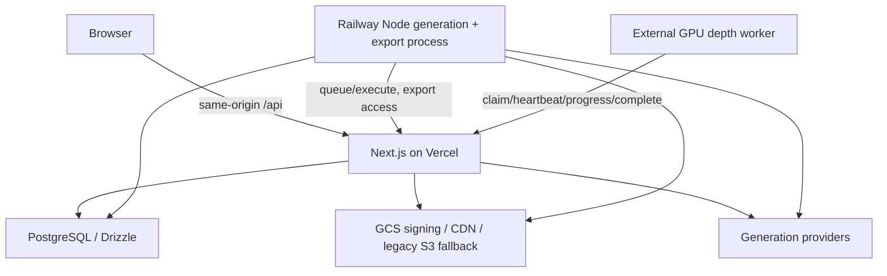

# Current-state audit — 2026-10-07

## Evidence and limits

Repository baseline: `a208e8aee3c6aa052a9482f996235e4992618a8b`, on the existing
`fix/preview-regressions-codex` branch, plus the pre-existing uncommitted Asset
Library work. Local `main` and cached `origin/main` both point at `6545e601`.
These are different trees. **The current deployed revision and live database
catalog have not been verified.** No production credential has been used.
Reconcile this checkout with the deployed release before any production cutover;
this document must not be presented as proof of the live schema.

2026-10-08 external reconciliation: read-only Railway metadata and selected
build/startup logs reveal an existing production `backend` running Gunicorn
26.0.0 and a historical Django preview associated by deployment message with
local Git object `4c98320`. Neither deployed source nor frontend traffic owner
is verified. This contradicts treating the diagram below as a proven live
deployment; it describes the current checkout's declared architecture.
See `railway-api-release.md` for service/deployment IDs, runtime fingerprints,
historical object evidence and remaining provenance/routing gates. No production
database credentials or application secrets were retrieved or used.
Read-only Vercel inspection subsequently confirms the production frontend is
reported as Next.js at baseline `a208e8`, with business API lambda outputs.
See `frontend-deployment-evidence.json`; compiled browser API-base overrides and
live route destinations remain unverified. This narrows the deployed-source
gap without proving traffic ownership or the database catalog.
Public production login assets were also inspected without API requests: their
API helper falls back to an empty base and their browser process shim has an
empty environment, with no API-origin injection found in the page HTML. This
supports same-origin login as an inference from compiled assets; authenticated
traffic and server forwarding remain unverified. Details are in the Railway
release review's public asset observation section.

Read the original scope in `source-request.txt` and mandatory isolation rule in
`isolation-requirement.txt`. `history-evidence.txt` records all locally reachable
branches and full graph, plus backend, API and schema histories. Remote refs are
cached observations, not proof that deleted/unfetched branches do not exist.

Inspected AGENTS.md, CLAUDE.md, progress.md, BACKEND_AUDIT.md,
DEPLOYMENT_RUNBOOK.md, package/config/CI files, current schema and migration
scripts, API inventory, auth and project/settings/folder services, worker
entrypoints, storage and naming/invariant implementation. The API inventory
covers all 65 route files / 85 explicit method handlers. Its static extractions
are **not** completed per-method behavioral contracts; those remain explicit
qualification work before each transfer. Older prose frequently describes an
obsolete implementation and is reference material only.

## Current repository architecture

Next API handlers own HTTP behavior. `src/lib/db.js` selects direct Postgres or
Cloud SQL connector configuration. No database infrastructure change is part of
this migration. Railway's root `railway.toml` builds `Dockerfile.worker`; that
runs `npm run worker:generation`, which also starts the export loop. Modules are
split, but process boundaries are not. `vercel.json` schedules login-attempt,
video-reconciliation and depth-reconciliation maintenance.

## Data and transactional surface

`src/lib/schema.js` contains 21 application tables; `model-design.md` records
field definitions and proposed domain owners. Drizzle's config table filter is
older than the schema: it omits portraits, idempotency and naming tables.
Do not use that filter as an exhaustive inventory or change it casually on a
shared DB. Millisecond timestamps are bigint, UUID IDs normally come from the
application, and several logical relationships intentionally have no FK.

The production verifier checks all declared columns and selected constraints,
indexes and triggers. It does not establish full type/default/function-body/
index-expression equivalence. A separate catalog equivalence gate is needed.
`test:db:setup` creates a latest schema; legacy-upgrade integration suites provide
distinct migration coverage and must remain.

Hierarchy uses project/global scope, nullable parent/project IDs, three partial
sibling-uniqueness indexes, RESTRICT FKs, normalization triggers and deferred
bidirectional scope triggers. Lock order: idempotency lock when applicable,
sorted scope advisory locks, deterministic row locks; batch and subtree moves
must remain atomic. Optimistic folder/version and generation/location-version
checks prevent stale writes. Current folder color work is part of the baseline.

Idempotency (`src/lib/idempotency.js`) stores a global key, actor, operation,
SHA-256 canonical payload fingerprint, result, and 24h expiry. Reuse across actor,
operation or payload yields distinct 409s. Mutation and result recording share a
transaction; PostgreSQL hashtext advisory locks serialize identical keys.

Naming uses `naming_counters` and `generation_naming`, positive sequences and
unique namespace/sequence. Deferred triggers protect location/name consistency.
`filename-resolver.js` defines current compact ancestry-based canonical names;
older namespace-token design prose does not override it. Direct signed downloads
and finalized ZIP entries must match. Manifest-v2 export names are frozen at
finalize; retry preserves them. Native MOV bytes/MIME/extensions are mandatory
for Seedance 2.5, independently of browser preview support.

## Auth and access

`veevee_session`: base64url JSON `{uid,ver,exp}` plus HMAC-SHA256. Versionless
legacy tokens mean version zero. 30-day TTL, renewal after one day; HttpOnly,
SameSite=Lax, host-only `/`, Secure in production. DB lookup rejects inactive or
auth-version-mismatched users. Passwords are Node scrypt (64 bytes; textual hex
salt), not Django's default hash format. Password cutover must preserve this.

Middleware only checks cookie presence; routes enforce identity/roles.
Projects are shared workspaces, not per-user tenants. `canManage` restricts
specific destructive/spend actions to owner/admin; null owner is admin-only.
Admin token setup/migration, cron, depth, export-access, media grants, callbacks,
and worker queue submission have distinct authentication paths. Preserve each.
Same-origin browser routing is required; audit unsafe-method Origin/CSRF behavior
before mutations transfer. Do not infer DRF SessionAuthentication is compatible
with the existing custom cookie.

## API and worker contracts

See `api-contract.yaml` and `api-matrix.md` for every explicit handler.
Implicit Next HEAD/OPTIONS and middleware responses must also be qualified.

First candidate: GET `/api/settings`, using global limits plus user overrides,
JS parseInt semantics and fallback/clamp rules. No storage/provider/job writes.
GET `/api/projects` is not read-only: it takes advisory lock 815042 and inserts
“My Project” if empty. Portrait GET can reconcile remote assets and write data;
admin inventory mode is a separate read-only path. History/status polling can
also advance/reconcile jobs. Review transitive behavior, not HTTP verb alone.

Generation coordination persists lease owner/deadline, next-poll timestamps,
poll attempts/errors, provider timing, callbacks, draft lineage, references and
pricing basis. Node coordinator submits via queue/execute and advances provider
status directly. Depth uses external outbound workers with versioned claim UUID
fencing; stale claims must fail on all write paths, including upload URL access.
Export claims use leases/retries, sequential source streaming, ZIP64 and GCS
resumable upload; final manifest names cannot be recomputed by the worker.

Provider modules: Gemini, Seedance, Seedream, Kling, Higgsfield MCP, Omni,
Magnific. Their current fixtures, validation, reference modes, quality controls,
pricing and errors—not older Python ports—define acceptance. Each needs shadow
payload parity, canary evidence, and explicitly authorized live output validation
before Python ownership. Worker rewrites wait for 100% Django API authority.

Canvas persists JSON boards by project; owner/admin checks gate destructive
operations. Conversations/messages persist agent kinds and tool traces; LLM
orchestration carries provider side effects. Admin stats, CSV headers, audit
logging, login throttling and limits are separate contracts, not generic CRUD.

## Storage

Current `storage.js` chooses GCS using backend/bucket configuration. It supports
WIF/IAM signing on Vercel and service-account credentials on Railway, time-bucketed
signed browser redirects, provider grants, resumable upload and protected key
namespaces. Large media stays direct-storage/CDN where appropriate. Optional
historical GCS-bucket fallback is read-only with protected-namespace exclusions;
optional S3 fallback remains until migration of historical content is proven.
No storage credential or real media was used for this audit.

## Historical Django attempts and reuse decisions

- `34dc430`: recovered Django/DRF port and TS-to-JS frontend conversion. Domain
  apps already appear in this first reachable backend introduction; do not invent
  a separate later split commit. `ee1e999` adds cleanup/security/test work.
- `12eaf9a` (2026-08-29), merged by `33f510a`: retired the uncut-over backend.
  Its CLAUDE.md diff explicitly says it never served production and dual behavior
  drift motivated choosing one runtime. This is recorded evidence, not a reason
  to repeat retirement.
- `0d7d211` / `f3bce05`: restored Django with a Vite cutover; corresponding
  infrastructure commits `5a69dae` / `6f23ceb`; model adoption commits
  `1bdf647` / `521fee9`; Seedance fixes `a836d12` / `7359956`;
  Seedream `1ec5b50`; latest substantial reachable restored tree `4c98320`.
  The pre-main consolidation stash also retains historical trees (`546bf86`).
  These are historical implementation snapshots, not proven complete parity.
- Historical domains: common (including auth), projects, assets, generation,
  media, canvas, agents, admin_dashboard. Deployment used Gunicorn/Railway and
  cross-origin configuration. Earlier unmanaged/test-managed models and later
  adoption migrations encode outdated schema ownership assumptions.
- Reuse candidates: pure HMAC/password helpers, media sniffing, prompt parsing,
  provider response fixtures, serialization tests. Review against current tests
  before copying. **No historical source has been restored as authoritative.**
- Deliberately discard historical flat Folder model (no nullable/global scope,
  hierarchy, colors/version/normalization), old generation model, cross-origin
  SameSite=None defaults, Vite replacement, blanket frontend API-base switch,
  test-only migration bypass, and assumptions of schema authority without live
  catalog equivalence. Old provider payloads omit later product behavior.

## Isolation and next gates

Local `.env.local`, `.env.railway_preview`, `.env.preview`, `.env.aws-migration`
and `.env` contain production/shared or unverified configuration. Local ADC and
Higgsfield token files exist. Values were not printed. Even loopback URLs are
untrusted until tied to a newly created disposable cluster. Qualification must
run from a clean copy excluding all env/credential files, with an allowlisted
child environment and isolated home directory. No tests or DB utilities were
run against those configured targets.

Next: ownership guard and ADR; isolated Django foundation; per-method settings
contract comparison against current Node with real disposable PostgreSQL; early
Railway deployment preparation. Live catalog inspection, Railway service creation,
production traffic transfer, DB baselining, secret removal, and billed provider
checks remain separately authorized operations. Main push can deploy production
(progress.md); no automatic push/merge is authorized by this local stage.
